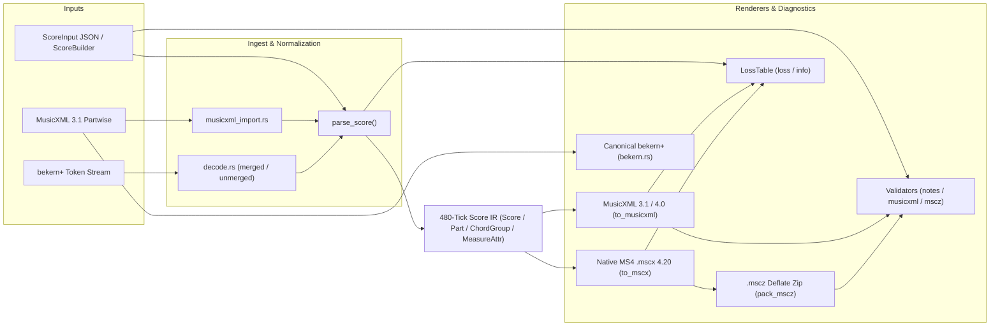

# Architecture — `mscz` (`mscz-rs`)

`mscz` is a pure-Rust, zero-GPL symbolic music notation engine. Every format — JSON note lists, MusicXML 3.1/4.0, native MuseScore 4 `.mscx`/`.mscz`, and `bekern+` token streams — converges on a single deterministic **480-tick intermediate representation (`Score`)** accompanied by an explicit **`LossTable`** and three-stage validators.

---

## Dataflow Overview



---

## Core Design Pillars

### 1. The 480-Tick Integer Grid (`SCORE_DIVISIONS = 480`)

Floating-point beat arithmetic accumulates drift across long scores, multi-voice `<backup>` offsets, and barline splits. `mscz` resolves all incoming onsets and durations to integer ticks immediately in [`parse_score`](src/lib.rs):

```text
start_ticks = round(onset_beats * divisions)
dur_ticks   = round(dur_beats   * divisions)
```

- **Why 480?** `480 = 2^5 × 3 × 5` divides cleanly by whole, half, quarter, eighth, 16th, 32nd, triplets, quintuplets, and sextuplets, and matches MuseScore's native `<Division>480</Division>`.
- **Measure windows (`Score::measure_windows`)**: Walks from tick `0` to `end_ticks`, consulting `MeasureAttr::time` at each 1-based measure so mid-stream meter changes (e.g., 4/4 → 3/4 → 6/8) produce exact `[m0, m1)` boundaries.
- **Deterministic chord & voice layout (`layout_part`)**:
  - Notes are stably sorted by `(start_ticks, voice, !grace, midi)` so grace notes always precede their anchor note.
  - Simultaneous same-voice notes with matching duration merge into a `ChordGroup`.
  - Overlaps within a voice never panic: partially covered notes are clamped (`overlap-clamped` loss), fully covered notes are dropped (`note-dropped-overlap` loss).
  - Notes crossing a barline split into per-measure segments with automatic `tie_out` / `tie_in` flags (lossless).
  - Gaps before, between, or after notes in any voice are filled with explicit rests (`rest-inserted` info) so every voice sums to the exact measure duration.

### 2. Tonal Pitch Class (`tpc`) Pitch Spelling

MuseScore stores every `<Note>` with both its sounding `<pitch>` (MIDI 0–127) and its enharmonic spelling `<tpc>` (Tonal Pitch Class) on the line of fifths, centered at `C = 14`:

```text
F = 13,  C = 14,  G = 15,  D = 16,  A = 17,  E = 18,  B = 19
tpc(step, alter) = base(step) + alter * 7
```

Examples:
- `C4` → `midi = 60`, `tpc = 14`
- `F#4` → `midi = 66`, `tpc = 13 + 7 = 20`
- `Gb4` → `midi = 66`, `tpc = 15 - 7 = 8`
- `Fx4` (double sharp) → `midi = 67`, `tpc = 13 + 14 = 27`

Because `parse_pitch` preserves `(step, alter, octave)` separately from `midi`, enharmonic spelling survives round-trips intact in both MusicXML (`<step>`, `<alter>`, `<accidental>`) and native MS4 `.mscx` (`<pitch>`, `<tpc>`). Only microtones (`+NNc` / `-NNc`) lose spelling precision, and they emit a `pitch-microtone-rounded` entry in the `LossTable`.

### 3. GCD-Reduced MuseScore 4 `<location>` Spanners

In MuseScore 4 `.mscx` (`version="4.20"`), cross-note and cross-bar spanners (`Tie`, `Slur`, `HairPin`) are stored as paired `<Spanner>` elements: the start endpoint carries `<next><location>...</location></next>` and the stop endpoint carries `<prev><location>...</location></prev>`.

`to_mscx` pairs spanners in a pre-pass over grouped voice items (`MscxItem`):
- **Ties**: paired per `(voice, midi)` across measures, honoring both barline-split ties and explicit `tie_start` / `tie_stop` links.
- **Slurs**: paired per `voice` across measures (`slur_start` → `slur_stop`).
- **Hairpins**: paired across measures on voice 0 (`cresc` / `dim` → `stop` or next hairpin or score end).

Each endpoint delta `(dm, df_ticks)` is serialized by `mscx_location_xml`:
- `<measures>{dm}</measures>` is emitted whenever `dm != 0`.
- `<fractions>{num}/{den}</fractions>` expresses `df_ticks` relative to one whole note (`whole = 4 * divisions`), reduced by `g = gcd(|df_ticks|, whole)` so MuseScore reads clean canonical fractions (e.g., `1/4`, `-3/4`) instead of unreduced tick ratios like `480/1920`.

### 4. `.mscz` Archive Packaging

`pack_mscz` builds a standard deflated ZIP archive entirely in memory (`Cursor<Vec<u8>>`):

```text
<score>.mscz
├── META-INF/container.xml   # points to <stem>.mscx and score_style.mss
├── <stem>.mscx              # MuseScore 4.20 XML document
└── score_style.mss          # Minimal MS4 style header (Spatium 1.74978)
```

Zero temporary files are created on disk, making the exact same code path work natively on desktop, servers, and `wasm32-unknown-unknown`.

### 5. Three-Stage Validators & `LossTable`

Every stage has an independent validator returning `Vec<Issue>` (`severity`: `"error"` | `"warning"`, stable `code`, human-readable `message`):

1. **`validate_notes(&ScoreInput)`** — checks divisions, time signature, finite non-negative onsets, positive durations, voice ≥ 1, pitch syntax/MIDI range, plus warnings for unsorted onsets, microtones, and onset gaps.
2. **`validate_musicxml(&str)`** — verifies XML declaration, `<score-partwise version="3.1">`, entity escaping, and runs a full per-measure tick accumulator honoring `<backup>`, `<forward>`, `<chord/>` (zero advance), and `<grace/>` (zero duration).
3. **`validate_mscz(&[u8])`** — opens the ZIP archive, verifies `META-INF/container.xml` rootfiles exist inside the archive, and checks that the `.mscx` entry contains `<museScore` and at least one `<Measure>`.

---

## Module Map

| Module | Responsibility |
|---|---|
| [`src/lib.rs`](src/lib.rs) | Core IR (`ScoreInput`, `Score`, `MeasureAttr`), `parse_score`, `LossTable`, `to_musicxml` / `to_musicxml_version` (3.1/4.0), `to_mscx`, `pack_mscz` / `pack_mscz_bytes`, `read_mscz`, validators, and Symbol Error Rate (`levenshtein`, `ser_for_inputs`) |
| [`src/builder.rs`](src/builder.rs) | Fluent `ScoreBuilder` and `PartBuilder` APIs for ergonomic Rust score construction |
| [`src/pitch.rs`](src/pitch.rs) | Scientific pitch parser, enharmonic step/alter representation, microtone cents rounding, and TPC helpers |
| [`src/musicxml_import.rs`](src/musicxml_import.rs) | MusicXML 3.1 parser → `ScoreInput` (whole score or paginated via `<print new-page="yes">`), `bekern_events`, `system_breaks`, and `split_measures` |
| [`src/bekern.rs`](src/bekern.rs) | Canonical `bekern+` encoder (`to_bekern`): semantic token stream with headers, voices, chords, tuplets (authoritative `<time-modification>`), grace notes, slurs, ties, dynamics, hairpins, and barlines |
| [`src/decode.rs`](src/decode.rs) | `bekern+` decoder (`decode_bekern` with merged ties for note-list scoring; `decode_bekern_unmerged` with link-faithful ties for MusicXML/MS4 export) |
| [`src/lattice.rs`](src/lattice.rs) | Measure-atomic top-2 candidate lattice sidecar validator & ranker (`cluster_size * (1.0 - confidence)`) for OMR human-in-the-loop review |
| [`src/main.rs`](src/main.rs) | Thin `clap` CLI wiring all 12 subcommands onto the library API |

---

## Zero-GPL & WASM Design

- **Permissive dependency tree**: `serde`, `serde_json`, `zip` (pure-Rust `deflate`), and optional `clap` (behind the `cli` feature). No MuseScore binary, no Qt, no Ghostscript, no C/C++ FFI, no GPL/AGPL crates.
- **No hidden I/O in library core**: all core parsing, rendering, packing, and validation functions accept `&str` / `&[u8]` and return `String` / `Vec<u8>`, so browser apps can run `mscz` directly inside a Web Worker or WASM module.
